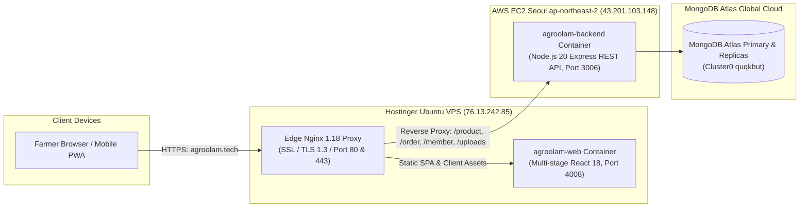

# 🚀 AgroOlam — Multi-Cloud Production Deployment & DevOps Architecture Guide

This guide documents the enterprise production deployment, multi-cloud networking, and containerization strategy powering **AgroOlam** ([https://agroolam.tech](https://agroolam.tech)).

---

## 🌐 1. Architectural Topology Overview

AgroOlam operates on a decoupled multi-cloud architecture engineered to deliver optimal regional performance across Central Asia and East Asia:



* **Frontend & Edge CDN**: Hostinger Cloud VPS (`76.13.242.85`) running Docker container `agroolam-web` behind Hostinger Nginx with automated Let's Encrypt SSL (`https://agroolam.tech`).
* **Backend API & Database**: AWS EC2 instance `AgroOlam-Server` (`43.201.103.148:3006`) running Docker container `agroolam-backend`, connected to MongoDB Atlas Cloud Cluster.
* **Unified Security & No CORS**: Hostinger Nginx handles all SSL termination and reverse-proxies `/product`, `/order`, `/member`, `/community`, `/uploads` to AWS port 3006. The browser interacts solely through HTTPS under `agroolam.tech` without Mixed Content or CORS errors.

---

## 🛠️ 2. Step-by-Step Server Setup & Deployment

### Step A: Hostinger VPS Edge Deployment (Frontend & SSL)

1. **Connect via SSH:**
   ```bash
   ssh root@76.13.242.85
   ```

2. **Clone & Build Frontend Container:**
   ```bash
   cd /root
   git clone -b main https://github.com/qazakhi515/AgroPlant-React.git agroolam-react
   cd agroolam-react
   docker compose -f docker-compose.prod.yml up -d --build
   ```
   *Verification:*
   ```bash
   docker ps | grep agroolam-web
   # Output: Up ... 127.0.0.1:4008->80/tcp  agroolam-web
   ```

3. **Configure Nginx Reverse Proxy (`/etc/nginx/conf.d/agroolam.conf`):**
   ```nginx
   map $http_upgrade $agroolam_connection_upgrade {
       default upgrade;
       ''      close;
   }

   server {
       server_name agroolam.tech www.agroolam.tech 76.13.242.85;
       client_max_body_size 50M;

       # 1. AWS Backend Proxy (Express REST API)
       location ~ ^/(product|order|member|community|admin|uploads) {
           proxy_pass http://43.201.103.148:3006;
           proxy_http_version 1.1;

           proxy_set_header Host $host;
           proxy_set_header X-Real-IP $remote_addr;
           proxy_set_header X-Forwarded-For $proxy_add_x_forwarded_for;
           proxy_set_header X-Forwarded-Proto $scheme;

           proxy_set_header Upgrade $http_upgrade;
           proxy_set_header Connection $agroolam_connection_upgrade;

           proxy_connect_timeout 10s;
           proxy_read_timeout 60s;
           proxy_send_timeout 60s;
       }

       # 2. Frontend SPA Web Container
       location / {
           proxy_pass http://127.0.0.1:4008;
           proxy_http_version 1.1;

           proxy_set_header Host $host;
           proxy_set_header X-Real-IP $remote_addr;
           proxy_set_header X-Forwarded-For $proxy_add_x_forwarded_for;
           proxy_set_header X-Forwarded-Proto $scheme;

           proxy_set_header Upgrade $http_upgrade;
           proxy_set_header Connection $agroolam_connection_upgrade;

           proxy_read_timeout 300s;
           proxy_send_timeout 300s;
       }

       listen [::]:443 ssl;
       listen 443 ssl;
       ssl_certificate /etc/letsencrypt/live/agroolam.tech/fullchain.pem;
       ssl_certificate_key /etc/letsencrypt/live/agroolam.tech/privkey.pem;
       include /etc/letsencrypt/options-ssl-nginx.conf;
       ssl_dhparam /etc/letsencrypt/ssl-dhparams.pem;
   }

   server {
       if ($host = www.agroolam.tech) {
           return 301 https://$host$request_uri;
       }
       if ($host = agroolam.tech) {
           return 301 https://$host$request_uri;
       }

       server_name agroolam.tech www.agroolam.tech 76.13.242.85;
       listen 80;
       listen [::]:80;

       location / {
           proxy_pass http://127.0.0.1:4008;
       }
   }
   ```

4. **Verify & Reload Nginx:**
   ```bash
   nginx -t && systemctl reload nginx
   ```

5. **SSL Certificate Automation (Certbot):**
   ```bash
   certbot --nginx -d agroolam.tech -d www.agroolam.tech
   ```
   Certbot installs auto-renewal timers (`systemctl list-timers | grep certbot`).

---

### Step B: AWS EC2 Core Deployment (Backend & Database)

1. **Instance Details:**
   * **Name**: `AgroOlam-Server`
   * **Instance ID**: `i-037738da9cdf4c20d` (t3.small, 2 vCPU, 2GB RAM)
   * **Region**: Seoul (`ap-northeast-2a`)
   * **Public IPv4**: `43.201.103.148`

2. **Security Group Configuration (`sg-091fc190e64e7e18a`):**
   * Port 22 (SSH): Restrict to administrative IPs.
   * Port 80 (HTTP): Allow 0.0.0.0/0.
   * Port 3006 (Custom TCP): Allow `0.0.0.0/0` (or strictly Hostinger VPS `76.13.242.85/32`).

3. **Docker Containers on AWS EC2 (`~/app`):**
   ```bash
   docker ps
   # Output:
   # agroolam-backend  Up ...  0.0.0.0:3006->3006/tcp
   # agroolam-frontend Up ...  0.0.0.0:80->80/tcp
   ```

4. **Health Check:**
   ```bash
   curl -I http://localhost:3006/product/all
   # Returns: HTTP/1.1 200 OK, X-Powered-By: Express
   ```

---

## 🔄 3. Continuous Integration & Deployment (CI/CD)

The GitHub Actions workflow at [`.github/workflows/ci.yml`](.github/workflows/ci.yml) executes on every push and pull request to `main` and `develop`:

1. **Automated Checkout**: Pulls code via `actions/checkout@v4`.
2. **Environment Setup**: Installs Node.js 20.x with Yarn cache.
3. **Dependency Resolution**: Runs `yarn install --prefer-offline`.
4. **Production Build**: Executes `yarn build` with `CI=false`.
5. **Unit & Smoke Tests**: Executes `yarn test --watchAll=false` to verify Redux store and component health.

---

## 🩺 4. Monitoring, Health Checks & Log Inspection

| Service | Diagnostic Command |
| :--- | :--- |
| **Frontend Container** | `docker logs -f agroolam-web` (on Hostinger VPS) |
| **Backend Container** | `docker logs -f agroolam-backend` (on AWS EC2) |
| **Nginx Access & Error** | `tail -f /var/log/nginx/error.log` (on Hostinger VPS) |
| **API End-to-End Test** | `curl -I https://agroolam.tech/product/all` |
| **SSL Expiration Check** | `certbot certificates` |

---

*Authored by Akhmadjon Usmonov — Lead Software Engineer & Architect for AgroOlam.*
