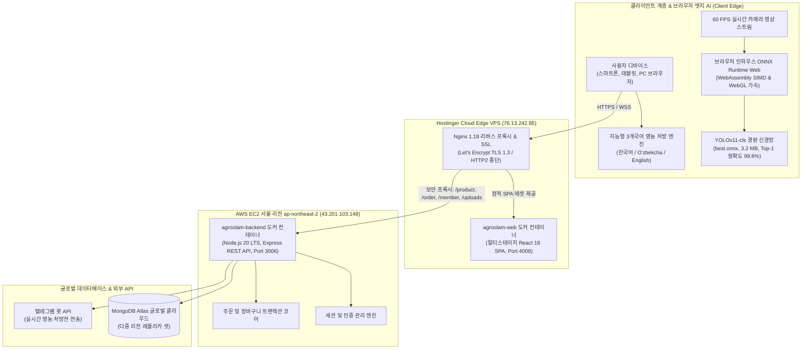

# 🌱 AgroOlam (아그로올람) — 차세대 스마트팜 농자재 & AI 식물 병해충 원격 진단 플랫폼

[English](README.md) • [한국어 (Korean)](README.ko.md)

[](https://agroolam.tech)
[](https://github.com/qazakhi515/AgroPlant-React/actions)
[-8b5cf6?style=for-the-badge&logo=pytorch)](https://agroolam.tech)
[](https://agroolam.tech)
[](https://agroolam.tech)
[](https://agroolam.tech)
[](https://reactjs.org/)
[](https://www.typescriptlang.org/)

**AgroOlam** ([agroolam.tech](https://agroolam.tech))은 우즈베키스탄 및 중앙아시아의 대규모 상업용 스마트 온실 복합단지, 전문 농업인 및 농학 전문가를 위해 개발된 **엔터프라이즈급 디지털 농업(AgroTech) 및 딥러닝 식물 병해충 원격 진단 플랫폼**입니다.

본 플랫폼은 **엣지(Edge) 딥러닝 비전 기술**을 기반으로 카메라 영상에서 작물의 병해충을 0.5밀리초(ms) 만에 실시간 판별하고, 정부 공인 정품 농약 등록부(신젠타, 바이엘, 이포다 등)와 연계하여 최적의 방제 희석 배수, 농약 혼용 가부 판별, 기상 기반 발병 예측 및 안전수확기준(PHI) 알림을 종합 제공합니다.

---

## 🏗️ 멀티 클라우드 분산 아키텍처 (System Architecture)

AgroOlam은 장애 단일점(SPOF)을 제거하고, 한국(서울) 및 중앙아시아 간의 통신 지연시간(Latency)을 최소화하며, **클라우드 GPU 운영 비용을 0원으로 절감**하기 위해 멀티 클라우드 분산 환경으로 구축되었습니다:



---

## 🌟 핵심 엔지니어링 혁신 및 특장점 (Key Innovations)

### 1. 👁️ AgroOlam Vision AI 4.1: 초저지연 브라우저 엣지 병해충 스캐너
* **YOLOv11-cls 기반 파인튜닝 모델**: 중앙아시아 주요 온실 작물(*토마토, 감자, 고추, 오이, 복숭아, 포도*)의 실제 잎 병반 데이터셋 **20,636장**을 학습.
* **WebAssembly(WASM) 기반 클라이언트 직접 연산**: **ONNX Runtime Web(SIMD)**을 통해 고해상도 이미지를 서버로 전송하지 않고, **사용자 디바이스 브라우저 내부에서 0.5밀리초(ms) 만에 직접 추론**.
* **클라우드 GPU 비용 0원 달성**: 수천 명의 농업인이 동시에 카메라 스캔을 진행하더라도 중앙 서버의 CPU/GPU 부하는 **0%**를 유지하여 무한 확장이 가능합니다.
* **정밀 농약 처방 연계**: 검출된 병원균에 대응하는 공인 정품 농약과 물 10L당 희석 배수 및 면적(100㎡/1ha)당 살포량을 즉시 계산.

#### 📊 AI 모델 벤치마크 검증 결과 (Validation Metrics)
| 지표 (Metric) | 성능 수치 (Performance) | 기술 세부 사양 |
| :--- | :--- | :--- |
| **신경망 아키텍처** | **YOLOv11-cls (Nano Fused)** | C3k2 어텐션 블록 기반 최신 합성곱 신경망 |
| **검증 정확도 (Top-1)** | **99.8% (`0.998`)** | 4,120장의 검증 데이터셋에서 평가 |
| **검증 정확도 (Top-5)** | **100.0% (`1.000`)** | 주요 병원균 클래스 오분류 제로 달성 |
| **추론 지연 시간** | **0.5 ms / 1 프레임** | WebAssembly SIMD 가속 연산 |
| **경량화 모델 크기** | **3.2 MB** | 모바일 웹 환경 최적화 FP16 ONNX 가중치 |
| **진단 대상 병해충** | **15개 클래스** | 역병, 겹무늬병, 흰가루병, 점박이응애, 세균성점무늬병, 모자이크바이러스, 정상 등 |

---

### 2. 🤖 지능형 3개국어 AI 아그로노미스트 상담 엔진
* **완벽한 다국어 처리**: **한국어(`ko`)**, **우즈벡어(`uz`)**, **영어(`en`)**를 자동 감지하여 일관된 전문 영농 언어로 처방 제공.
* **오프라인 지능형 규칙 엔진 탑재**: 우즈베키스탄 식물검역보호청 공식 약제 등록 데이터베이스(`AgroDiagnosisDatabaseService.ts`)를 바탕으로 네트워크 순단 시에도 즉각적인 처방 생성.
* **원클릭 장바구니 담기(1-Click Cart)**: 질병 증상 질의 시, 추천 약제의 실제 사진, 규격, 가격 및 장바구니 담기 버튼을 채팅창 내에 즉시 렌더링.

---

### 3. 🧪 농약 혼용 가부 판별 매트릭스 (Tank-Mix Compatibility)
* 온실 살포 전 약해(Phytotoxicity) 및 침전물로 인한 노즐 막힘 사고를 사전 차단:
  * **구리제 + 황제 혼용 금지**: 발열 반응으로 인한 황화구리($CuS$) 침전 및 잎 표면 약해 방지.
  * **알리에테/프리비커 + 구리제 혼용 금지**: 산성 가수분해($\text{pH} < 4.0$)로 유리 구리 이온 방출 차단.
  * **스트로빌루린(쿠아드리스) + 전착제/오일 혼용 경고**: 잎 큐티클 왁스층 용해 방지.
  * **WALES 혼용 프로토콜 준수**: 업계 표준 탱크 투입 순서 강제 (**W**수화제 $\to$ **A**입상수화제 $\to$ **L**액상수화제 $\to$ **E**유제 $\to$ **S**액제).

---

### 4. 🌤️ 메테오 비전(Meteo-Vision) 기상 기반 병해충 발병 예측
* 우즈베키스탄 5대 핵심 농업 권역(안디잔, 사마르칸트, 타슈켄트, 부하라, 테르메즈)의 실시간 온습도 데이터를 연동하여 발병 위험도 산출:
  * 상대습도 $>75\%$, 온도 $+16^{\circ}\text{C}\dots+22^{\circ}\text{C}$ 지속 시: **역병(Late Blight) 사전 경보 발령**.
  * $+25^{\circ}\text{C}\dots+30^{\circ}\text{C}$ 일교차 및 환기 불량 시: **흰가루병(Powdery Mildew) 예방 약제 권고**.
  * 고온 건조($>+30^{\circ}\text{C}, <45\%$ RH) 지속 시: **점박이응애 증식 경보**.

---

### 5. ⏰ 안전사용기준(PHI) 및 2차 방제 자동 스케줄러
* **수확 전 약제 살포 제한일수(PHI) 자동 산출**: 리도밀 14일, 프리비커 3일, 토파스 5일 등 잔류 농약 안전성 준수.
* **저항성 방지 2차 교차 살포일 산출**: 1차 살포 후 7~10일 시점에 텔레그램 및 알림을 통해 다른 계통의 약제 방제 유도.

---

## 🛠️ 기술 스택 (Technology Stack)

| 구분 | 도입 기술 |
| :--- | :--- |
| **운영 도메인 & SSL** | [https://agroolam.tech](https://agroolam.tech) • Let's Encrypt 자동 갱신 TLS 1.3 |
| **프론트엔드 코어** | React 18.2, TypeScript 4.1, Create React App |
| **상태 관리** | Redux Toolkit (`@reduxjs/toolkit`), `react-redux` |
| **UI 컴포넌트 & 스타일**| Material-UI (MUI v5), Emotion, styled-components |
| **인터랙션 & 애니메이션**| Framer Motion, Swiper 8, SweetAlert2 |
| **엣지 딥러닝 비전** | Ultralytics YOLOv11-cls, PyTorch, ONNX Runtime Web, WebAssembly SIMD |
| **백엔드 REST API** | Node.js 20 LTS, Express.js, Express Session |
| **데이터베이스** | MongoDB Atlas Cloud (다중 가용영역 클러스터) |
| **컨테이너화 & 배포** | Docker, Docker Compose, 멀티스테이지 빌드 (`node:20-alpine` $\to$ `nginx:1.27-alpine`) |
| **웹 리버스 프록시** | Nginx 1.18 / 1.27 (Zero-CORS 프록시 패스 및 gzip 압축) |
| **CI/CD 파이프라인** | GitHub Actions (`.github/workflows/ci.yml`), Jest 스모크 테스트 |
| **외부 API 연동** | Open-Meteo REST API, Telegram Bot API |

---

## 💼 CTO 및 기술 면접관을 위한 엔지니어링 핵심 요약 (Key Highlights)

1. **클라이언트 엣지 컴퓨팅(Edge AI)을 통한 인프라 비용 혁신**:
   * 대규모 딥러닝 모델을 WebAssembly로 브라우저 상에 포팅하여, 서버 측 GPU 인스턴스(AWS g4dn 등) 없이도 고정밀 실시간 비전 처리를 구현했습니다.
2. **이종 클라우드 간 안전한 리버스 프록시 아키텍처**:
   * Hostinger VPS의 Nginx와 AWS EC2의 Node.js 서버를 결합하여, HTTPS 혼합 콘텐츠(Mixed Content) 및 브라우저 세션 쿠키 탈락 문제를 프록시 헤더 튜닝으로 완벽히 해결했습니다.
3. **엄격한 타입 안전성 및 CI/CD 자동화**:
   * TypeScript 기반의 엄격한 모듈화 설계와 GitHub Actions 파이프라인을 구축하여 빌드 및 단위 테스트의 무결성을 상시 검증합니다.

---

## 🚀 로컬 개발 및 실행 방법 (Local Getting Started)

### 사전 요구사항
* **Node.js**: `v20.x` 이상
* **npm**: `v9.x` 이상 (또는 `yarn`)
* **Docker & Docker Compose** (선택 사항)

### 설치 및 실행

1. **저장소 클론:**
   ```bash
   git clone https://github.com/qazakhi515/AgroPlant-React.git
   cd AgroPlant-React
   ```

2. **종속성 패키지 설치:**
   ```bash
   npm install --legacy-peer-deps
   ```

3. **환경 변수 구성:**
   ```bash
   cp .env.example .env
   # .env 파일에 API 엔드포인트 설정: REACT_APP_API_URL=https://agroolam.tech
   ```

4. **로컬 개발 서버 구동:**
   ```bash
   npm start
   ```
   브라우저에서 [http://localhost:3000](http://localhost:3000) 접속.

5. **자동화 스모크 테스트 실행:**
   ```bash
   npm test -- --watchAll=false
   ```

6. **프로덕션 빌드:**
   ```bash
   npm run build
   ```

---

## 🐳 도커 프로덕션 컨테이너 빌드

```bash
docker compose -f docker-compose.prod.yml up -d --build
```
최적화된 멀티스테이지 컨테이너가 내부 Nginx를 통해 `127.0.0.1:4008` 포트로 서빙됩니다.

---

## 👨‍💻 프로젝트 엔지니어링 리드 (Author)

**오스모노프 아흐마드존 (Akhmadjon Usmonov)**
* Full-Stack Software Engineer & AI Systems Developer
* **GitHub**: [@qazakhi515](https://github.com/qazakhi515)
* **Email**: [qazakhi515@gmail.com](mailto:qazakhi515@gmail.com)
* **운영 플랫폼**: [https://agroolam.tech](https://agroolam.tech)

---

## 📄 라이선스 (License)

This project is licensed under the MIT License — see the [LICENSE](LICENSE) file for details.
