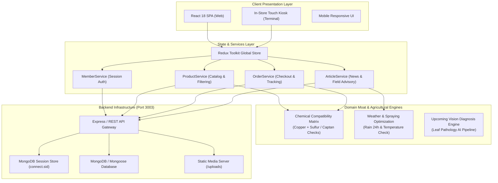

# 🌱 Agrivia — Smart Agricultural & Plant Farm Platform

[](https://github.com/qazakhi515/AgroPlant-React/actions/workflows/ci.yml)
[](https://reactjs.org/)
[](https://www.typescriptlang.org/)
[](https://redux-toolkit.js.org/)
[](https://mui.com/)
[](https://opensource.org/licenses/MIT)

**Agrivia** is an enterprise-grade digital agriculture ecosystem connecting modern farmers, greenhouse operators, and gardeners with high-grade seeds, certified fertilizers, agrochemicals, and expert agronomic advice. Built with deep domain insights in plant pathology, seed genetics, and crop protection.

---

## 🏗️ System Architecture



---

## 🌟 Key Features

### 1. 🌾 Agricultural E-Commerce Catalog
- **Categorized Agro Supplies**:
  - `PLANTS` — Greenhouse and open-field seedlings.
  - `SEEDS` — F1 high-yield, disease-resistant hybrid seed packs.
  - `FERTILIZERS` — Mineral, organic, and systemic fungicides/insecticides.
  - `TOOLS` — Spraying systems, irrigation equipment, and hand tools.
  - `OTHER` — Farm protective equipment and soil conditioners.
- **Dynamic Search & Multi-Order Sorting**: Filter by newest arrivals, volume/weight, and view counts.

### 2. 📰 News & Agricultural Advisory Module
- **Field-Tested Knowledge Base**: In-depth treatment guides for major regional crop diseases (e.g., Powdery Mildew, Late Blight).
- **Integrated Product Recommendations**: Direct purchase recommendations embedded within treatment manuals for seamless grower support.
- **Categorized Feeds**: Disease prevention, seasonal sowing guides, and regional market trends.

### 3. 🛡️ Chemical Compatibility Engine (Domain Moat)
- Prevents toxic mixture mistakes commonly made by growers during tank preparation:
  - Prohibits mixing **copper-based fungicides** with **elemental sulfur** to prevent phytotoxic foliage burn.
  - Enforces mandatory 14-day intervals between **Captan** and **mineral oil** applications.
  - Warns against calcium-phosphate precipitation that clogs sprayer nozzles.

### 4. 🛒 Full-Cycle Order Management
- Real-time shopping basket with quantity calculation and persistent session management.
- Multi-status order dashboard: **Paused**, **In Process**, and **Finished** order verification.

---

## 🛠️ Technology Stack

| Layer | Technologies |
| :--- | :--- |
| **Frontend Core** | React 18, TypeScript, Create React App |
| **State Management** | Redux Toolkit (`@reduxjs/toolkit`), `react-redux` |
| **UI Framework** | Material-UI (MUI v5), `@mui/joy`, Emotion, styled-components |
| **Sliders & Motion** | Swiper 8, SweetAlert2 |
| **HTTP & Networking**| Axios with resilient offline fallback integration |
| **Routing** | React Router v5 |
| **CI/CD** | GitHub Actions Automated Build & Verification Pipeline |

---

## 🚀 Getting Started

### Prerequisites
- **Node.js**: `v16.x` or `v18.x`
- **Package Manager**: `yarn` or `npm`
- **Backend API**: Running AgroPlant backend service (defaults to `http://localhost:3003`)

### Installation

1. **Clone the repository:**
   ```bash
   git clone https://github.com/qazakhi515/AgroPlant-React.git
   cd AgroPlant-React
   ```

2. **Install dependencies:**
   ```bash
   yarn install
   ```

3. **Configure Environment:**
   Create a `.env` file in the root directory:
   ```env
   REACT_APP_API_URL=http://localhost:3003
   ```

4. **Start Development Server:**
   ```bash
   yarn start
   ```
   Open [http://localhost:3000](http://localhost:3000) in your browser.

5. **Build for Production:**
   ```bash
   yarn build
   ```

---

## 🗺️ Phased Roadmap (Next Milestones)

- [x] **Phase 1: Domain Sanitization & Branding**: Transition all legacy restaurant structures into an agricultural platform.
- [x] **Phase 2: News & Field Advisory System**: Dynamic agronomic articles with linked treatment products.
- [x] **Phase 3: CI/CD Pipeline Integration**: Automated verification on every branch push.
- [ ] **Phase 4: AI Leaf Disease Computer Vision**: Multimodal leaf disease classification and automated prescription generator.
- [ ] **Phase 5: In-Store Self-Service Kiosk Mode**: Touchscreen workflow for farm shops to reduce consultation queues from 10 minutes to 2 minutes with shelf location routing.

---

## 👨‍💻 Author

**Akhmadjon Usmonov**
* Agricultural Domain Specialist & Full-Stack Software Engineer
* Email: [qazakhi515@gmail.com](mailto:qazakhi515@gmail.com)
* GitHub: [@qazakhi515](https://github.com/qazakhi515)

---

## 📄 License

This project is licensed under the MIT License — see the [LICENSE](LICENSE) file for details.
