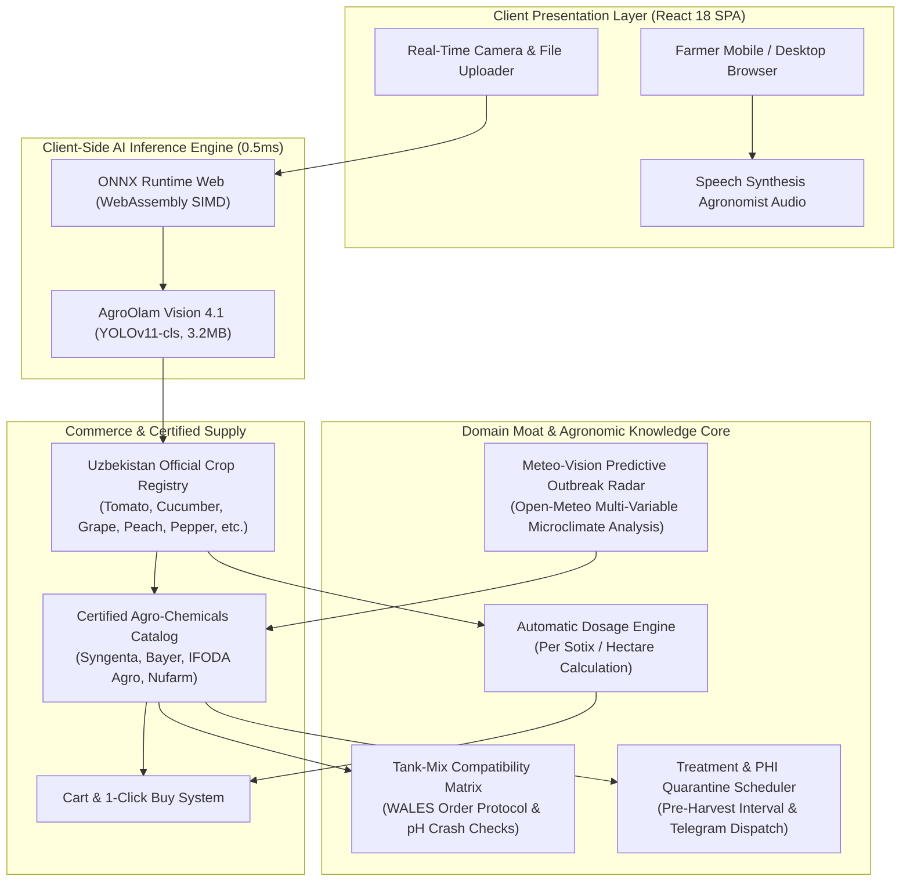

# 🌱 AgroOlam — Enterprise AgroTech, Greenhouse Supply & Plant Pathology AI Platform

[](https://agroolam.tech)
[-purple?style=for-the-badge&logo=pytorch)](https://agroolam.tech)
[](https://agroolam.tech)
[](https://reactjs.org/)
[](https://www.typescriptlang.org/)
[](https://opensource.org/licenses/MIT)

**AgroOlam** ([agroolam.tech](https://agroolam.tech)) is an enterprise-grade digital agriculture and plant pathology platform tailored for greenhouse operators, agronomists, and commercial farmers across Uzbekistan and Central Asia. The platform bridges real-time neural vision pathology diagnosis with official national chemical registries, smart spray compatibility matrices, and predictive meteorological disease warnings.

---

## 🏗️ System Architecture



---

## 🌟 Core Capabilities & Innovations

### 1. 👁️ AgroOlam Vision AI 4.1 Real-Time Pathology Scanner
- **Fine-Tuned YOLOv11-cls Neural Architecture**: Trained on over **20,636 validated leaf images** across 15 agricultural classes relevant to Uzbekistan crops (*Tomato, Potato, Bell Pepper, Cucumber, Grape, Peach*).
- **Zero-Latency In-Browser Inference**: Runs entirely client-side via **ONNX Runtime Web WebAssembly (WASM)** with average latency of **0.5 milliseconds per frame**, requiring zero server GPU costs.
- **Automated Prescription Generator**: Immediately outputs the pathogen species, urgency index, foliar necrosis stage, climate optimization (temperature/humidity), and exact certified chemical treatments.

#### 📊 AI Model Benchmarks (Validation Results)
| Metric | Performance |
| :--- | :--- |
| **Model Architecture** | YOLOv11-cls (Nano Fused) |
| **Validation Top-1 Accuracy** | **99.8% (`0.998`)** |
| **Validation Top-5 Accuracy** | **100.0% (`1.000`)** |
| **Pre-process / Inference Latency** | **0.1ms preprocess / 0.5ms inference** |
| **Export Format & Size** | ONNX (Opset 12, 224x224), **5.9 MB** (Weights: 3.2 MB) |
| **Trained Classes** | 15 Classes (Late Blight, Early Blight, Spider Mites, Bacterial Spot, Mosaic Virus, etc.) |

---

### 2. 🧪 Tank-Mix Chemical Compatibility Evaluation Matrix
- Prevents catastrophic sprayer mixtures and foliar leaf burn before mixing in the field:
  - **Copper + Sulfur Exclusion**: Warns against exothermic copper sulfide ($CuS$) precipitation that scorches leaves.
  - **Aliette / Previcur + Copper Incompatibility**: Prevents acid-base hydrolysis where low pH ($<4.0$) releases free toxic $Cu^{2+}$ ions.
  - **Quadris + Horticultural Oils**: Blocks strobilurin mixing with mineral oils that dissolve leaf cuticular wax layers.
  - **Calcium + Phosphate Sludge Prevention**: Stops calcium nitrate and MKP phosphate combinations that clog sprayer nozzles.
  - **WALES Mixing Protocol**: Enforces the industry-standard addition sequence (**W**ettable powders $\to$ **A**gitate granules $\to$ **L**iquid suspensions $\to$ **E**mulsifiable concentrates $\to$ **S**oluble liquids).

---

### 3. 🌤️ Meteo-Vision Predictive Outbreak Radar
- **Live Regional Agro-Meteo Integration**: Fetches real-time microclimate conditions across 5 key agricultural regions of Uzbekistan:
  - *Andijan (Fergana Valley Greenhouse Hub)*
  - *Samarkand (Open-field Horticulture & Orchards)*
  - *Tashkent / Zangiata (Commercial Supply & Agro-clusters)*
  - *Bukhara (Arid & Saline Precision Farming)*
  - *Termez / Surkhandarya (Subtropical Early-Harvest Basin)*
- **Pathology Risk Modeling**:
  - Automatically calculates outbreak probability: Late Blight alert triggers at $>75\%$ RH and $+16^{\circ}\text{C}\dots+22^{\circ}\text{C}$; Powdery Mildew at $+25^{\circ}\text{C}\dots+30^{\circ}\text{C}$ with fluctuating humidity; Spider Mites at $>+30^{\circ}\text{C}$ and $<45\%$ dry air.
  - Recommends proactive preventative treatments with 1-click cart addition before symptoms manifest.

---

### 4. ⏰ Post-Purchase Treatment & PHI Quarantine Reminder
- **Pre-Harvest Interval (PHI) Calculation**: Automatically determines mandatory food safety withholding periods (e.g., 14 days for Ridomil, 3 days for Vertimec, 1 day for organic bioprep) based on the grower's active cart.
- **Repeat Spray Scheduling**: Computes 7-to-10 day repeat intervals and schedules personalized SMS and Telegram alerts to prevent chemical resistance.

---

### 5. 🛒 Certified Agro-Chemical & Supply Marketplace
- Official registered medicines from global and domestic manufacturers:
  - **Syngenta**: *Ridomil Gold MZ, Skor 250 EC, Vertimec 018 EC, Revus 250 SC, Quadris 250 SC, Switch 62.5 WG, Bravo 500 SC, Proclaim 05 SG, Aktara 25 WG*.
  - **Bayer CropScience**: *Infinito 687.5 SC, Luna Tranquility, Envidor 240 SC, Belt 480 SC, Aliette 80 WG*.
  - **IFODA Agro & Nufarm**: *Ento-Fito Super, Cuproxat 345 SC, Kocide 2000*.
- Greenhouse 3-layer anti-drip EVA films (150 micron, 6m / 12m / 15m), F1 hybrid seeds (Sayxun, Bobkat, Miracle, Vesta), and automated drip irrigation lines.

---

## 🛠️ Technology Stack

| Layer | Technologies |
| :--- | :--- |
| **Domain & Production** | `https://agroolam.tech` |
| **Frontend Core** | React 18, TypeScript, Create React App |
| **AI / Machine Learning** | Ultralytics YOLOv11-cls, PyTorch, Google Colab (Tesla T4 GPU) |
| **In-Browser Inference**| ONNX Runtime Web (`onnxruntime-web`), WebAssembly SIMD |
| **State Management** | Redux Toolkit (`@reduxjs/toolkit`), `react-redux` |
| **Design & UI** | Material-UI (MUI v5), `@mui/joy`, Emotion, styled-components |
| **Animation & UX** | Framer Motion, Swiper 8, SweetAlert2 |
| **Weather & APIs** | Open-Meteo REST API, Axios |
| **Internationalization** | Trilingual Support (Uzbek `uz`, English `en`, Korean `ko`) |

---

## 🚀 Getting Started

### Prerequisites
- **Node.js**: `v16.x` or `v18.x`
- **Package Manager**: `npm` or `yarn`

### Installation

1. **Clone the repository:**
   ```bash
   git clone https://github.com/qazakhi515/AgroPlant-React.git
   cd AgroPlant-React
   ```

2. **Install dependencies:**
   ```bash
   npm install --legacy-peer-deps
   ```

3. **Configure Environment:**
   Create a `.env` file in the root directory:
   ```env
   REACT_APP_API_URL=https://api.agroolam.tech
   ```

4. **Start Development Server:**
   ```bash
   npm start
   ```
   Open [http://localhost:3000](http://localhost:3000) in your browser.

5. **Build for Production:**
   ```bash
   npm run build
   ```

---

## 👨‍💻 Author

**Akhmadjon Usmonov**
* Full-Stack Software Engineer & Agricultural AI Practitioner
* Email: [qazakhi515@gmail.com](mailto:qazakhi515@gmail.com)
* GitHub: [@qazakhi515](https://github.com/qazakhi515)
* Domain: [agroolam.tech](https://agroolam.tech)

---

## 📄 License

This project is licensed under the MIT License — see the [LICENSE](LICENSE) file for details.
